

# INSERT COIN

### Todos tus juegos. Una sola biblioteca. Cero excusas para no jugar.

**Steam · Epic Games · GOG · EA · Ubisoft · Battle.net · Riot · Amazon · itch.io · Rockstar · Xbox · Humble · Legacy Games**

**[▶ Ver el vídeo completo (1:32)](https://jesusjacky.github.io/InsertCoin-descargas/)** Música: «It Takes A Hero», de Zane Little Music (CC0)

---

> **En una frase:** Insert Coin es un programa **gratuito** para Windows que junta en una sola pantalla **todos los juegos que ya tienes**
> en Steam, Epic, GOG, EA, Ubisoft, Battle.net y demás tiendas, para que no tengas que ir abriéndolas una por una.

## 🛡️ ¿Es de fiar? Lo que hace y lo que NO hace

| ✅ Lo que hace | 🚫 Lo que NO hace nunca |
|---|---|
| **Lee** la lista de juegos que tus tiendas ya guardan en tu PC | No pide **contraseñas** ni que inicies sesión en nada |
| Busca la portada, la nota y los datos de cada juego **por su nombre** | No **envía tus datos** a nadie: ni tu lista de juegos, ni tu nombre, ni tu correo |
| Abre la **tienda oficial** cuando pulsas «Jugar» o «Instalar» | No **cambia nada** de tus tiendas ni de tus partidas |
| Se **actualiza** desde esta misma página | No lleva **publicidad**, ni cuentas, ni instala otros programas |

- **¿Quién está detrás?** Una persona: **JesusJacky**, que lo hace como proyecto personal. Contacto: **jesusJacky.InsertCoin@gmail.com**.
- **¿Por qué Windows avisa al instalarlo?** Porque la app aún no tiene un **certificado de firma** (cuestan dinero cada año y
  esto es gratuito). Windows avisa de **cualquier** programa nuevo sin firmar, no porque haya encontrado nada. Pulsa
  «Más información» → «Ejecutar de todos modos».
- **Está en fase beta:** funciona, pero puede tener algún fallo. Si ves uno, cuéntalo desde «💬 Sugerencias» en la propia app.

<!-- NOVEDADES:INICIO -->
## 🆕 Lo nuevo en la versión 0.3.4 · Ofertas por secciones y escaneo exprés

- **✨ Nuevo:** La ventana de **🏷️ Ofertas**, renovada y por secciones: **🎁 Gratis** (juegos gratis para siempre en cualquier plataforma, con filtro), **🏷️ Ofertas** (las mejores rebajas de Steam, GOG, Humble, Fanatical, Epic… con **filtro por tienda** y orden), **📦 Bundles** (muy pronto) y **⭐ Tus deseados**.
- **✨ Nuevo:** **Rebajas destacadas de Steam** en euros, con la cuenta atrás de cuándo terminan (ideal para las ofertas de un día o de fin de semana).
- **✨ Nuevo:** Aviso cuando aparece en tu biblioteca un juego que tenías en tu **lista de deseados**: puedes quitarlo de la lista, o pedir que no te avise más de ese juego. Se puede apagar en 🪙 → Ajustes → Avisos.
- **⬆️ Mejora:** El **primer escaneo** es muchísimo más rápido: el año, los géneros y el estudio de cada juego (Wikidata) se piden de 50 en 50 en vez de uno a uno. Lo que antes podía tardar más de una hora ahora son unos minutos.
- **🔧 Arreglo:** Wikimedia frenaba a Insert Coin a 10 consultas por minuto porque no se identificaba con una web de contacto. Ahora lo hace con su página de descargas (se identifica la app, nunca a ti) y puede ir a velocidad normal.
- **⬆️ Mejora:** Desaparece el paso «Wikipedia» del escaneo: ya no hacía falta.
- **🔧 Arreglo:** Las **notificaciones de Windows** (versión nueva disponible, ofertas de tus deseados) no llegaban a salir en la app instalada. Ahora sí.
- **⬆️ Mejora:** Los textos legales pasan a la versión 4: avisan de que Insert Coin está en **fase beta** y de que en el futuro sus funciones o condiciones pueden cambiar o limitarse (siempre con aviso antes). Se piden aceptar una vez más.
- **⬆️ Mejora:** Aviso de **autoría**: en «Acerca de» y en el aviso legal consta que Insert Coin es una obra original de JesusJacky, con todos los derechos reservados.
- **⬆️ Mejora:** Los juegos con el mismo nombre ya no se confunden al buscar su año y su estudio (por ejemplo, el God of War de 2018 ya no toma los datos del de 2005).

**[📜 Todas las novedades, versión a versión →](NOVEDADES.md)**
<!-- NOVEDADES:FIN -->

## 🕹️ ¿Qué es?

¿Cuántas tiendas de juegos tienes instaladas? ¿Cinco? ¿Seis? ¿Y cuántas veces has comprado en una oferta un juego **que ya tenías** en otra?

**Insert Coin** lee tus launchers y junta **todos tus juegos en una sola biblioteca**, con su portada, tus horas, tus logros, el año, lo que opina la gente… Si tienes el mismo juego en varias tiendas, sale **una sola vez**. Y desde ahí mismo **lo juegas o lo instalas**.

<table>
<tr>
<td width="50%" valign="top">

### ▶️ Juega e instala sin abrir mil tiendas
Pulsa **Jugar** y Insert Coin le pide a su tienda oficial que lo abra. ¿No está instalado? **Instalar** te lleva directo a su instalación. La tienda sigue haciendo su trabajo: comprueba que es tuyo, cuenta tus horas y guarda tus partidas.

</td>
<td width="50%">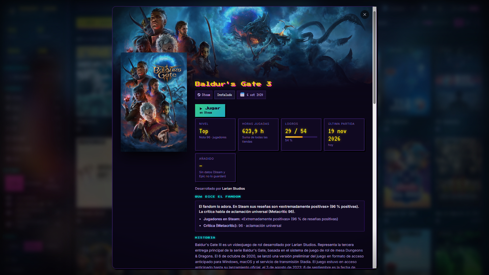</td>
</tr>
<tr>
<td width="50%">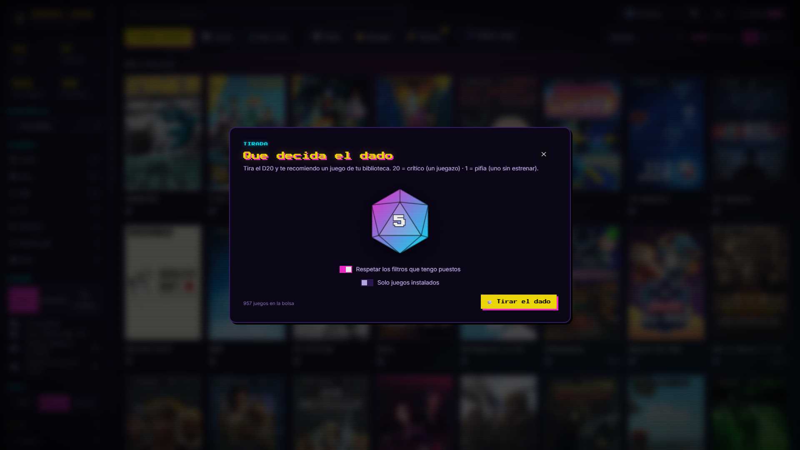</td>
<td width="50%" valign="top">

### 🎲 ¿No sabes a qué jugar? Que decida el dado
Tira un **D20** y te recomienda un juego de tu biblioteca: un **20 crítico** es un juegazo; una **pifia**, uno de esos que compraste y nunca estrenaste. O haz el **test de ánimo** y te dice qué te apetece de verdad.

</td>
</tr>
<tr>
<td width="50%" valign="top">

### 💀 Tu perfil de jugador
¿Qué juegas de verdad? Porcentaje de tus horas por tipo de juego, tus más jugados, lo último que has jugado… y **un título que te has ganado**: *«Eres un estratega»*, *«¡Wololo!»*, *«Cada muerte es un nuevo comienzo»*…

</td>
<td width="50%">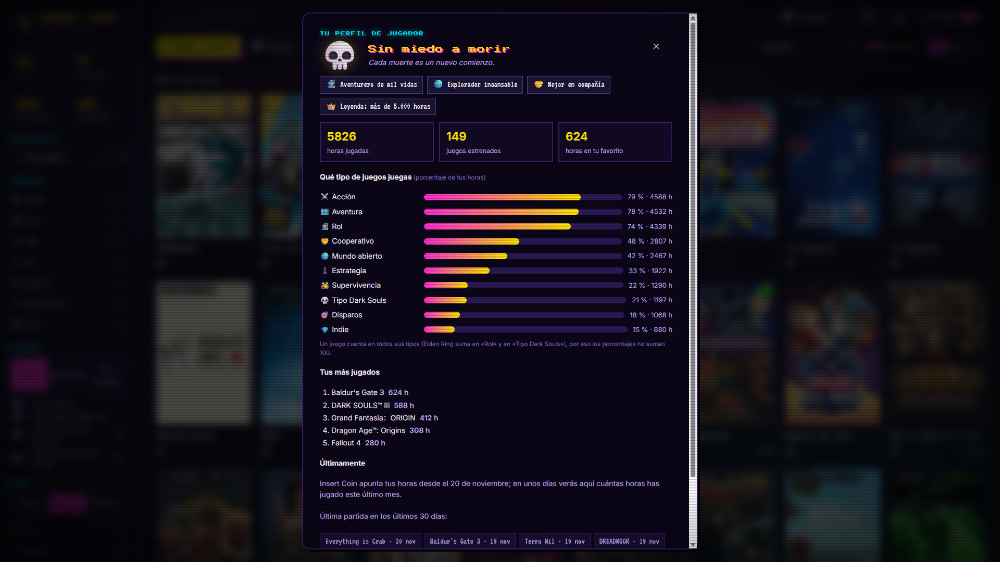</td>
</tr>
<tr>
<td width="50%">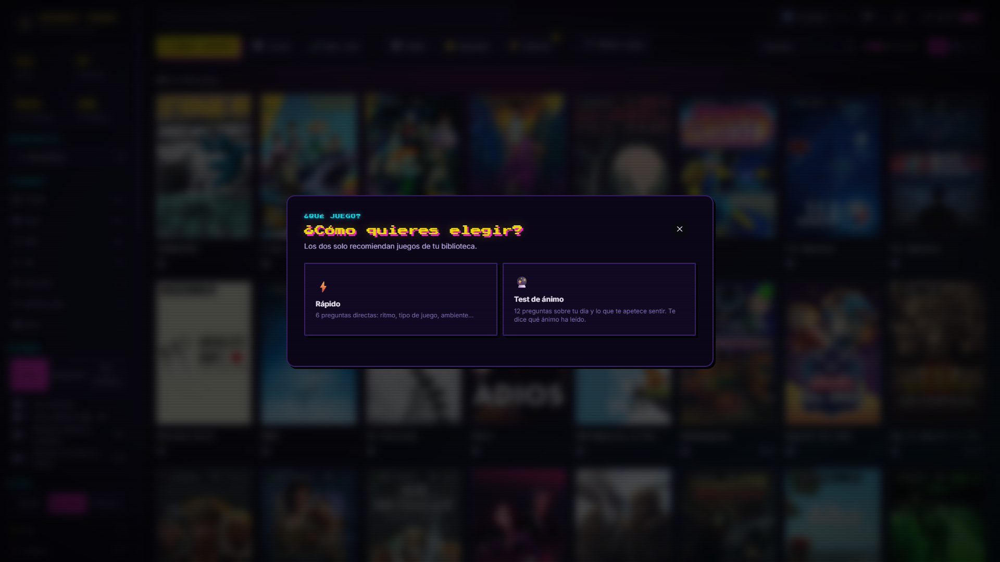</td>
<td width="50%" valign="top">

### 🧠 Test «¿Qué juego?»
Unas preguntas rápidas sobre cómo estás hoy (¿cansado?, ¿con ganas de pensar?, ¿un rato corto?) y te saca los juegos de tu biblioteca que mejor encajan.

</td>
</tr>
</table>

## 🏛️ La colección de clásicos

Más de **230 juegos que hicieron historia**, de *Space Invaders* a *Baldur's Gate 3*. Los que tienes llevan la etiqueta 🏛️ y su
**Historia**, escrita para Insert Coin: quién lo hizo, qué se atrevió a cambiar y por qué se recuerda. Si tienes un **remake** o una
**remasterización** (*Dead Space*, *Resident Evil 4*, *Age of Empires II: Definitive Edition*…), comparte la historia del original y
suma **la suya propia**. Y los que **te faltan** salen en tu biblioteca **apagados y sin portada**, con un 🔒, hasta que los consigues.
¿Cuántos tienes tú?

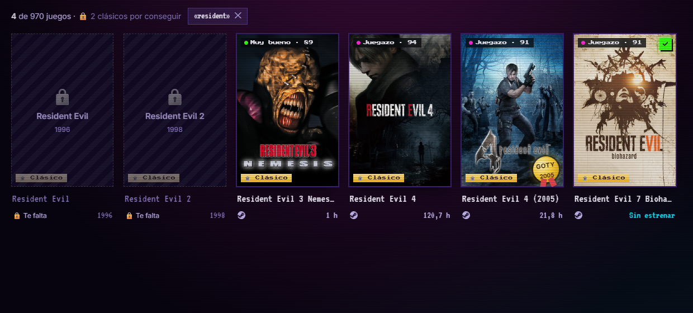
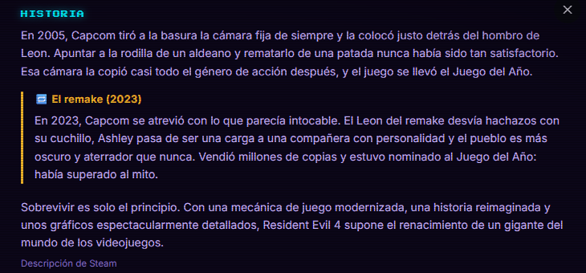

## 🛋️ Modo sofá

Coge el mando, túmbate y elige desde el sofá: **pantalla completa**, tus juegos en filas («Seguir jugando», «Instalados», «Para estrenar»…), el elegido en grande con sus capturas de fondo y **sonidos retro**. Funciona con mandos de Xbox y PlayStation (o con el teclado). Y si lo dejas quieto… *INSERT COIN*.

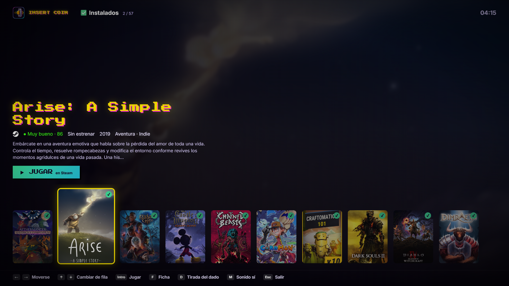

## 🏷️ Ofertas, juegos gratis y ⭐ deseados

Para el que no tiene ganas de mirar tienda por tienda: **todo en una ventana**, por secciones.

- 🎁 **Gratis:** los juegos que se pueden conseguir **gratis para siempre** ahora mismo, en Steam, Epic, GOG, itch.io… (y si quieres, también en móvil y consola).
- 🏷️ **Ofertas:** las mejores rebajas de **Steam, GOG, Humble, Fanatical, Epic, Green Man Gaming…**, con **filtro por tienda** y orden por descuento o precio.
  Las **rebajas destacadas de Steam**, en euros y con la cuenta atrás de cuándo terminan (las de un día o de fin de semana).
- 📦 **Bundles:** packs de varios juegos a precio de risa, con los juegos que trae cada uno *(muy pronto)*.
- ⭐ **Tus deseados:** apunta los juegos que quieres y te avisa cuando **bajan de precio** o se **regalan**. Y si alguno aparece ya en tu biblioteca, te lo dice.

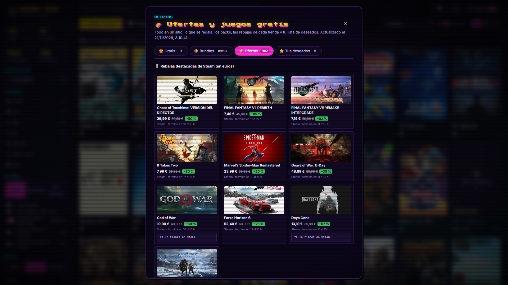
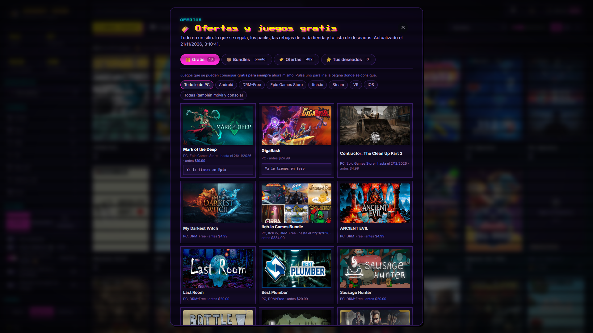

Insert Coin no vende juegos ni cobra comisiones: cada oferta te lleva a su tienda. Precios de Steam en euros; los del resto de tiendas, en dólares (vienen de <a href="https://www.cheapshark.com">CheapShark</a>, que solo trabaja en dólares). Juegos gratis gracias a <a href="https://www.gamerpower.com">GamerPower</a>.

## 🎨 21 estilos para tu biblioteca

Recreativa de neón, cyberpunk, JRPG por turnos, tele de tubo, terminal, ventana de los 90, survival horror… Cambia el aspecto entero con un clic.

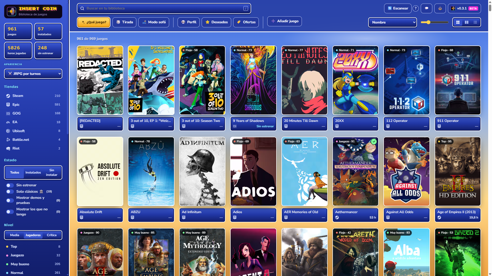
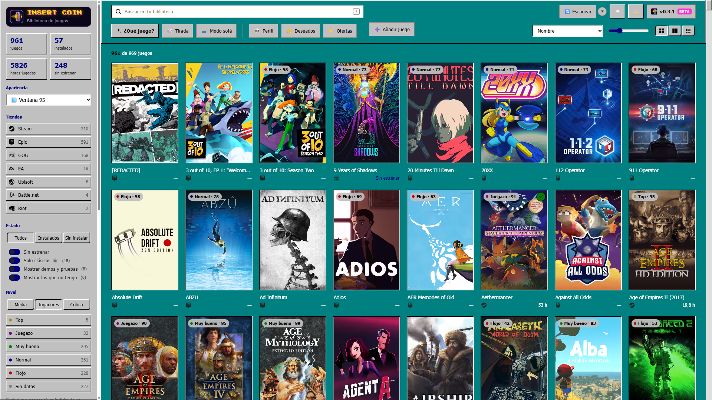

## ✨ Y además

| | |
|---|---|
| 🏆 **Logros** de Steam y GOG con su progreso | 🏛️ **Colección de clásicos**: más de 230 juegos que hicieron historia, cada uno con su historia (y la de su remake); los que te faltan salen apagados hasta que los consigues |
| 📖 **Fichas completas**: descripción, capturas, vídeos y la insignia **GOTY** de los Juegos del Año | 🗣️ **Qué dice el fandom**: el resumen de lo que opinan jugadores y crítica |
| 🔍 **Filtros de todo tipo**: tienda, género, cooperativo, PvP, sin estrenar, nota… | ✍️ **Tu nivel y tu crítica** para cada juego |
| 🔄 **Se actualiza sola**: tu biblioteca y la propia app | 🐢 **Modo ligero** para PCs antiguos, con **análisis de tu equipo** |
| ➕ **Añade a mano** lo que una tienda no guarde en el PC | 📰 **Novedades** de cada versión dentro de la app |
| 🔔 **Avisos**: versión nueva, ofertas de tus deseados y deseados que ya tienes | 🧩 **Una sola carta** aunque tengas el juego en varias tiendas |

## 🔒 Tus datos son tuyos

- Tu biblioteca se lee **en tu PC y solo leyendo**: Insert Coin **nunca cambia nada** de tus launchers.
- **Sin cuentas, sin publicidad, sin analítica.** No se envían tus datos a nadie: para completar cada juego solo se consulta su nombre en servicios públicos (tienda de Steam, Wikipedia, Wikidata…).

## 💻 Requisitos

### 🪟 Windows

| | Mínimos | Recomendados |
|---|---|---|
| **Sistema** | Windows 10 (64 bits) | Windows 10 u 11 (64 bits) |
| **Procesador** | 2 núcleos (de 2010 en adelante, p. ej. Intel Core i3 de 1.ª generación) | 4 núcleos o más |
| **Memoria** | 4 GB | 8 GB |
| **Disco** | 500 MB libres | 500 MB libres en un SSD |
| **Pantalla** | 1280 × 720 | 1920 × 1080 |
| **Internet** | Para completar los datos de los juegos y buscar ofertas | Lo mismo |

### 🐧 Linux (versión de prueba)

| | Mínimos | Recomendados |
|---|---|---|
| **Sistema** | 64 bits (x86-64): Ubuntu 22.04, Linux Mint 21, Debian 12, Fedora 38 o similares | Ubuntu 24.04 o equivalente reciente |
| **Procesador** | 2 núcleos (de 2010 en adelante) | 4 núcleos o más |
| **Memoria** | 4 GB | 8 GB |
| **Disco** | 500 MB libres | 500 MB libres en un SSD |
| **Pantalla** | 1280 × 720 | 1920 × 1080 |
| **Para leer tu biblioteca** | Steam instalado (por ahora solo se lee Steam) | Lo mismo |

### 🍎 Mac (versión de prueba)

| | Mínimos | Recomendados |
|---|---|---|
| **Sistema** | macOS 12 Monterey | macOS 14 Sonoma o más nuevo |
| **Procesador** | Chip de Apple (M1 o posterior). Los Mac con procesador Intel no son compatibles | M2 o posterior |
| **Memoria** | 8 GB | 8 GB o más |
| **Disco** | 500 MB libres | 500 MB libres |
| **Pantalla** | 1280 × 800 | La del propio Mac |
| **Para leer tu biblioteca** | Steam instalado (por ahora solo se lee Steam) | Lo mismo |

> En equipos justos, activa el **Modo ligero** (menú 🪙 → Ajustes); el botón **«Analizar mi equipo»** te dice si te conviene.
> En todos los sistemas hace falta **internet** para completar los datos de los juegos y buscar ofertas.

## ⬇️ Descargar

Ve a **[la última versión](../../releases/latest)** y descarga la de tu sistema:

| Sistema | Archivo | |
|---|---|---|
| 🪟 **Windows 10 / 11** (64 bits) | `Insert-Coin-Instalador-X.Y.Z.exe` | ✅ Recomendada |
| 🐧 Linux | `Insert-Coin-X.Y.Z-Linux.AppImage` | 🧪 Prueba (solo lee Steam) |
| 🍎 Mac (chip Apple) | `Insert-Coin-X.Y.Z-Mac.dmg` | 🧪 Prueba (solo lee Steam) |

> [!NOTE]
> **¿Sale «Windows protegió su PC»?** Es normal: la app no tiene un certificado de firma (cuesta dinero cada año y esto es un proyecto personal y gratuito), no porque tenga nada malo. Pulsa **«Más información» → «Ejecutar de todos modos»**.

Instrucciones completas (también Linux y Mac) en el **[LEEME](LEEME.txt)** · Qué trae cada versión en **[NOVEDADES](NOVEDADES.md)**.

## ❓ Preguntas frecuentes

<b>¿Es gratis?</b>

Sí. Es una **beta**: una versión de prueba, gratis, que puede tener algún fallo. Si ves uno, cuéntalo desde el botón «💬 Sugerencias» de la app.

<b>¿Lleva virus, publicidad o algo raro?</b>

No. No tiene publicidad, no instala nada más, no pide permisos de administrador para funcionar y no envía tu información a nadie. Si Windows avisa al instalarlo es solo porque aún no tiene certificado de firma (mira «¿Es de fiar?», arriba).

<b>¿Quién lo ha hecho?</b>

**JesusJacky**, como proyecto personal, por pura pereza de abrir seis tiendas para saber qué juegos tiene 😅. Puedes escribirle a **jesusJacky.InsertCoin@gmail.com** o desde «💬 Sugerencias» en la app.

<b>¿Necesito una cuenta o dar mis contraseñas?</b>

No. Insert Coin no pide cuentas ni contraseñas: lee lo que tus launchers ya guardan en tu PC.

<b>¿Puede romper algo de mis tiendas o de mis juegos?</b>

No. Solo **lee** sus archivos, nunca los cambia. Y para jugar o instalar, se lo pide a la propia tienda con sus enlaces oficiales.

<b>¿Por qué falta algún juego?</b>

Algunas tiendas no guardan en el PC todo lo que tienes comprado (Epic, Battle.net o Xbox, por ejemplo). Los que falten se pueden **añadir a mano** y los que sobren, **ocultar**.

<b>¿Funciona en un PC antiguo?</b>

Sí, desde un **Intel Core i3 de 1.ª generación con 4 GB** de memoria, con **Windows 10 u 11 de 64 bits** (mira los requisitos). En equipos modestos activa el **Modo ligero** (menú 🪙 → Ajustes): quita solo los efectos que más cargan. El botón «Analizar mi equipo» te dice si te conviene; en PCs muy justos se activa solo.

<b>¿Cómo se actualiza?</b>

Sola: te avisa cuando hay versión nueva (punto amarillo en el botón 🪙) y la instalas con un clic. Tu biblioteca y tus ajustes se quedan como están.

---

Aquí están los **instaladores** y la información pública de Insert Coin; el código de la aplicación no es público. 
Insert Coin es gratis y se ofrece «tal cual». Las marcas, portadas y textos de los juegos y las tiendas son de sus dueños; Insert Coin no está afiliada a ninguna.

**Un proyecto personal de JesusJacky** · © 2026 JesusJacky. Todos los derechos reservados ([LICENCIA](LICENSE)) · 🪙 *Inserta una moneda para continuar…*

