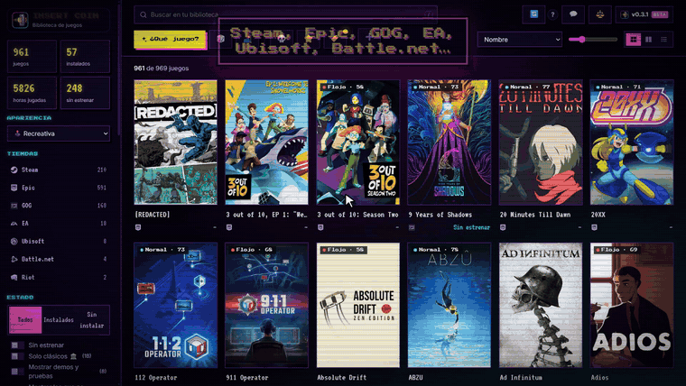
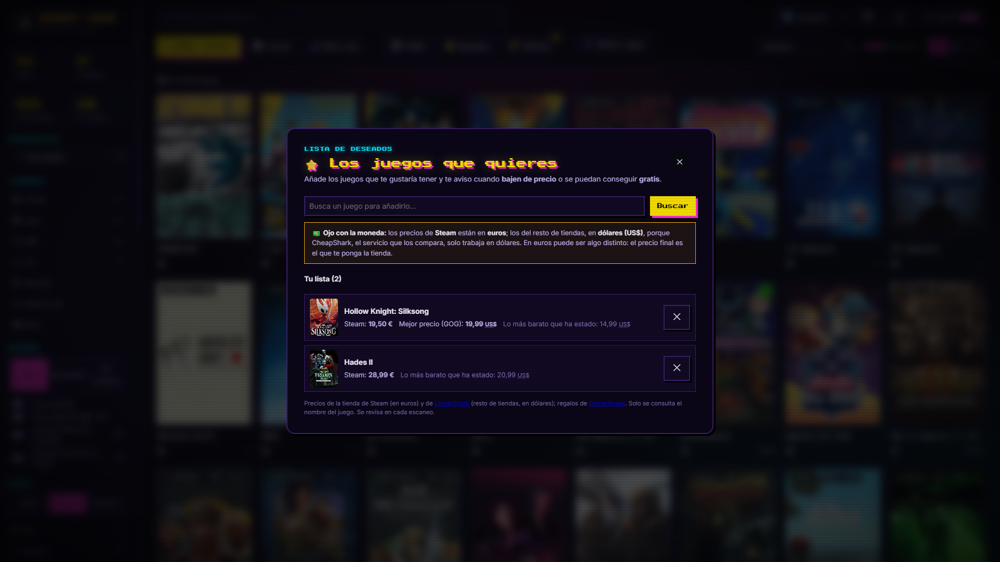
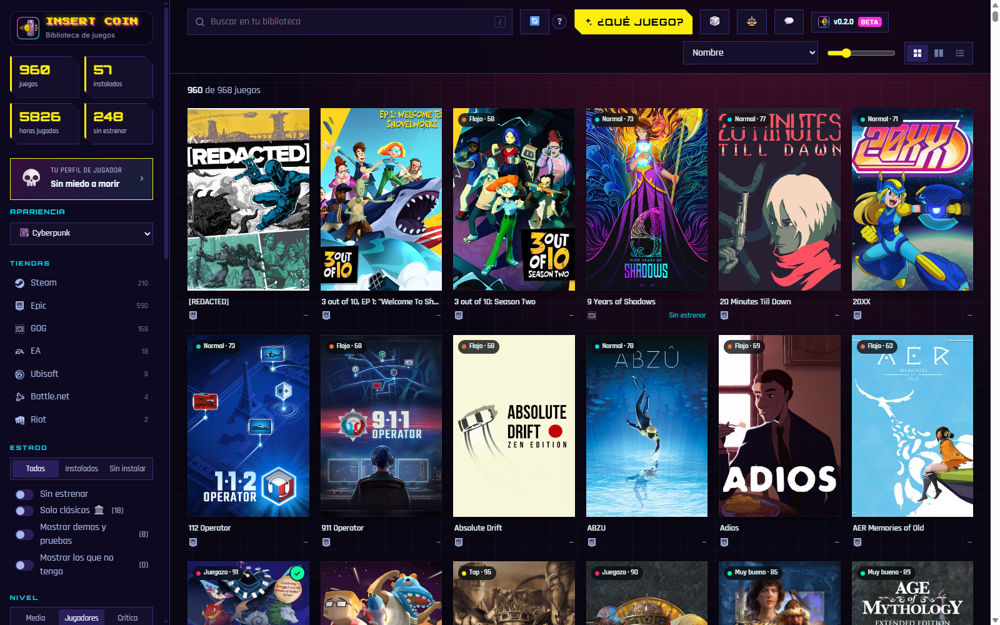

# INSERT COIN

### Todos tus juegos. Una sola biblioteca. Cero excusas para no jugar.

**Steam · Epic Games · GOG · EA · Ubisoft · Battle.net · Riot · Amazon · itch.io · Rockstar · Xbox · Humble · Legacy Games**

**[▶ Ver el vídeo completo (1:32)](https://jesusjacky.github.io/InsertCoin-descargas/)** Música: «It Takes A Hero», de Zane Little Music (CC0)

---

## 🕹️ ¿Qué es?

¿Cuántas tiendas de juegos tienes instaladas? ¿Cinco? ¿Seis? ¿Y cuántas veces has comprado en una oferta un juego **que ya tenías** en otra?

**Insert Coin** lee tus launchers y junta **todos tus juegos en una sola biblioteca**, con su portada, tus horas, tus logros, el año, lo que opina la gente… Si tienes el mismo juego en varias tiendas, sale **una sola vez**. Y desde ahí mismo **lo juegas o lo instalas**.

<table>
<tr>
<td width="50%" valign="top">

### ▶️ Juega e instala sin abrir mil tiendas
Pulsa **Jugar** y Insert Coin le pide a su tienda oficial que lo abra. ¿No está instalado? **Instalar** te lleva directo a su instalación. La tienda sigue haciendo su trabajo: comprueba que es tuyo, cuenta tus horas y guarda tus partidas.

</td>
<td width="50%"></td>
</tr>
<tr>
<td width="50%"></td>
<td width="50%" valign="top">

### 🎲 ¿No sabes a qué jugar? Que decida el dado
Tira un **D20** y te recomienda un juego de tu biblioteca: un **20 crítico** es un juegazo; una **pifia**, uno de esos que compraste y nunca estrenaste. O haz el **test de ánimo** y te dice qué te apetece de verdad.

</td>
</tr>
<tr>
<td width="50%" valign="top">

### 💀 Tu perfil de jugador
¿Qué juegas de verdad? Porcentaje de tus horas por tipo de juego, tus más jugados, lo último que has jugado… y **un título que te has ganado**: *«Eres un estratega»*, *«¡Wololo!»*, *«Cada muerte es un nuevo comienzo»*…

</td>
<td width="50%"></td>
</tr>
<tr>
<td width="50%"></td>
<td width="50%" valign="top">

### 🧠 Test «¿Qué juego?»
Unas preguntas rápidas sobre cómo estás hoy (¿cansado?, ¿con ganas de pensar?, ¿un rato corto?) y te saca los juegos de tu biblioteca que mejor encajan.

</td>
</tr>
</table>

## 🛋️ Modo sofá

Coge el mando, túmbate y elige desde el sofá: **pantalla completa**, tus juegos en filas («Seguir jugando», «Instalados», «Para estrenar»…), el elegido en grande con sus capturas de fondo y **sonidos retro**. Funciona con mandos de Xbox y PlayStation (o con el teclado). Y si lo dejas quieto… *INSERT COIN*.

## ⭐ Deseados y 🏷️ ofertas

Apunta los juegos que quieres y Insert Coin te avisa cuando **bajan de precio** o se pueden conseguir **gratis**. Además, cada día: los **juegos gratis** del momento en PC y los que ya tienes que están tirados de precio en otra tienda.

Precios de Steam en euros; los del resto de tiendas, en dólares (vienen de <a href="https://www.cheapshark.com">CheapShark</a>, que solo trabaja en dólares). Juegos gratis gracias a <a href="https://www.gamerpower.com">GamerPower</a>.

## 🎨 21 estilos para tu biblioteca

Recreativa de neón, cyberpunk, JRPG por turnos, tele de tubo, terminal, ventana de los 90, survival horror… Cambia el aspecto entero con un clic.

## ✨ Y además

| | |
|---|---|
| 🏆 **Logros** de Steam y GOG con su progreso | 🏛️ **Clásicos**: los juegos que hicieron historia |
| 📖 **Fichas completas**: descripción, capturas, vídeos e historia del juego | 🗣️ **Qué dice el fandom**: el resumen de lo que opinan jugadores y crítica |
| 🔍 **Filtros de todo tipo**: tienda, género, cooperativo, PvP, sin estrenar, nota… | ✍️ **Tu nivel y tu crítica** para cada juego |
| 🔄 **Se actualiza sola**: tu biblioteca y la propia app | 🐢 **Modo ligero** para PCs antiguos, con **análisis de tu equipo** |
| ➕ **Añade a mano** lo que una tienda no guarde en el PC | 📰 **Novedades** de cada versión dentro de la app |

## 🔒 Tus datos son tuyos

- Tu biblioteca se lee **en tu PC y solo leyendo**: Insert Coin **nunca cambia nada** de tus launchers.
- **Sin cuentas, sin publicidad, sin analítica.** No se envían tus datos a nadie: para completar cada juego solo se consulta su nombre en servicios públicos (tienda de Steam, Wikipedia, Wikidata…).

## 💻 Requisitos

### 🪟 Windows

| | Mínimos | Recomendados |
|---|---|---|
| **Sistema** | Windows 10 (64 bits) | Windows 10 u 11 (64 bits) |
| **Procesador** | 2 núcleos (de 2010 en adelante, p. ej. Intel Core i3 de 1.ª generación) | 4 núcleos o más |
| **Memoria** | 4 GB | 8 GB |
| **Disco** | 500 MB libres | 500 MB libres en un SSD |
| **Pantalla** | 1280 × 720 | 1920 × 1080 |
| **Internet** | Para completar los datos de los juegos y buscar ofertas | Lo mismo |

### 🐧 Linux (versión de prueba)

| | Mínimos | Recomendados |
|---|---|---|
| **Sistema** | 64 bits (x86-64): Ubuntu 22.04, Linux Mint 21, Debian 12, Fedora 38 o similares | Ubuntu 24.04 o equivalente reciente |
| **Procesador** | 2 núcleos (de 2010 en adelante) | 4 núcleos o más |
| **Memoria** | 4 GB | 8 GB |
| **Disco** | 500 MB libres | 500 MB libres en un SSD |
| **Pantalla** | 1280 × 720 | 1920 × 1080 |
| **Para leer tu biblioteca** | Steam instalado (por ahora solo se lee Steam) | Lo mismo |

### 🍎 Mac (versión de prueba)

| | Mínimos | Recomendados |
|---|---|---|
| **Sistema** | macOS 12 Monterey | macOS 14 Sonoma o más nuevo |
| **Procesador** | Chip de Apple (M1 o posterior). Los Mac con procesador Intel no son compatibles | M2 o posterior |
| **Memoria** | 8 GB | 8 GB o más |
| **Disco** | 500 MB libres | 500 MB libres |
| **Pantalla** | 1280 × 800 | La del propio Mac |
| **Para leer tu biblioteca** | Steam instalado (por ahora solo se lee Steam) | Lo mismo |

> En equipos justos, activa el **Modo ligero** (menú 🪙 → Ajustes); el botón **«Analizar mi equipo»** te dice si te conviene.
> En todos los sistemas hace falta **internet** para completar los datos de los juegos y buscar ofertas.

## ⬇️ Descargar

Ve a **[la última versión](../../releases/latest)** y descarga la de tu sistema:

| Sistema | Archivo | |
|---|---|---|
| 🪟 **Windows 10 / 11** (64 bits) | `Insert Coin - Instalador X.Y.Z (Windows)` | ✅ Recomendada |
| 🐧 Linux | `Insert-Coin-X.Y.Z-Linux.AppImage` | 🧪 Prueba (solo lee Steam) |
| 🍎 Mac (chip Apple) | `Insert-Coin-X.Y.Z-Mac.dmg` | 🧪 Prueba (solo lee Steam) |

> [!NOTE]
> **¿Sale «Windows protegió su PC»?** Es normal: la app no tiene un certificado de firma (cuesta dinero cada año y esto es un proyecto personal y gratuito), no porque tenga nada malo. Pulsa **«Más información» → «Ejecutar de todos modos»**.

Instrucciones completas (también Linux y Mac) en el **[LEEME](LEEME.txt)** · Qué trae cada versión en **[NOVEDADES](NOVEDADES.md)**.

## ❓ Preguntas frecuentes

<b>¿Es gratis?</b>

Sí. Es una **beta**: una versión de prueba, gratis, que puede tener algún fallo. Si ves uno, cuéntalo desde el botón «💬 Sugerencias» de la app.

<b>¿Necesito una cuenta o dar mis contraseñas?</b>

No. Insert Coin no pide cuentas ni contraseñas: lee lo que tus launchers ya guardan en tu PC.

<b>¿Puede romper algo de mis tiendas o de mis juegos?</b>

No. Solo **lee** sus archivos, nunca los cambia. Y para jugar o instalar, se lo pide a la propia tienda con sus enlaces oficiales.

<b>¿Por qué falta algún juego?</b>

Algunas tiendas no guardan en el PC todo lo que tienes comprado (Epic, Battle.net o Xbox, por ejemplo). Los que falten se pueden **añadir a mano** y los que sobren, **ocultar**.

<b>¿Funciona en un PC antiguo?</b>

Sí, desde un **Intel Core i3 de 1.ª generación con 4 GB** de memoria, con **Windows 10 u 11 de 64 bits** (mira los requisitos). En equipos modestos activa el **Modo ligero** (menú 🪙 → Ajustes): quita solo los efectos que más cargan. El botón «Analizar mi equipo» te dice si te conviene; en PCs muy justos se activa solo.

<b>¿Cómo se actualiza?</b>

Sola: te avisa cuando hay versión nueva (punto amarillo en el botón 🪙) y la instalas con un clic. Tu biblioteca y tus ajustes se quedan como están.

---

Aquí están los **instaladores** y la información pública de Insert Coin; el código de la aplicación no es público. 
Insert Coin es gratis y se ofrece «tal cual». Las marcas, portadas y textos de los juegos y las tiendas son de sus dueños; Insert Coin no está afiliada a ninguna.

**Un proyecto personal de JesusJacky** · 🪙 *Inserta una moneda para continuar…*

